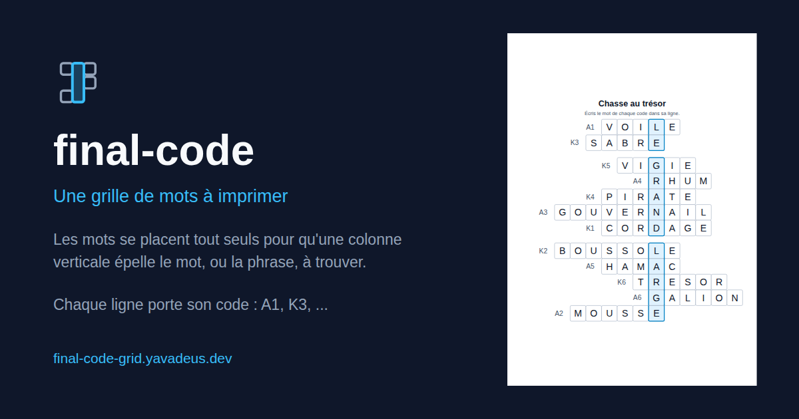

<div align="center">


# final-code

**Une liste de mots, une solution à trouver, et une feuille A4 à imprimer : les
mots se placent tout seuls pour qu'une colonne verticale épelle la solution.**

[**Ouvrir l'application**](https://final-code-grid.yavadeus.dev) &nbsp;·&nbsp;
[Comment ça marche](#ce-que-ça-fait) &nbsp;·&nbsp;
[Documentation technique](AGENTS.md)

<a href="https://final-code-grid.yavadeus.dev">
  
</a>

<sub>
  100 % front-end &nbsp;·&nbsp; React 19 + TypeScript &nbsp;·&nbsp;
  zéro dépendance de rendu &nbsp;·&nbsp; licence MIT
</sub>

</div>

---

## Ce que ça fait

Vous donnez la solution à trouver et la liste des mots, chacun précédé de son code :

```
A1 ballon
A2 gateau
K1 invitation
```

L'outil cherche **quel mot va sur quelle ligne** et **à quelle lettre l'accrocher**,
puis sort la grille la plus étroite qui marche, en A4 portrait. Sur la feuille,
chaque ligne montre des cases vides et son code à gauche ; la colonne encadrée est
celle où se lira la solution. Le bouton **Voir la solution** imprime le corrigé.

C'est fait pour une chasse au trésor : le joueur trouve le mot du code `A1` sur le
terrain, l'écrit dans la ligne `A1`, et la colonne finit par livrer le mot mystère.
Les codes sont libres, donc deux séries peuvent cohabiter (`A1` à `A6` pour une
zone, `K1` à `K6` pour une autre).

La solution peut être une **phrase** : les espaces ne prennent pas de case, mais
les lignes se détachent en autant de groupes que de mots à trouver.

La feuille s'exporte en **PDF** (A4 exact, écrit sans bibliothèque, donc à l'abri
des réglages du dialogue d'impression) ou en **SVG**, et s'imprime directement.

Si aucune grille n'existe, l'outil dit pourquoi : la lettre qu'aucun mot ne porte,
le mot qui ne sert à rien, ou les lignes qui se disputent le même mot.

---

## Démarrer

Le site est en ligne : **[final-code-grid.yavadeus.dev](https://final-code-grid.yavadeus.dev)**. En local :

```sh
make install
make start          # http://localhost:2277
```

| Commande | Effet |
|---|---|
| `make check` | build + lint + typecheck + knip + tests |
| `make test` | tests unitaires et de composants |
| `make fix` | formate puis lint |

`make help` liste tout.

La marque et l'image de partage sont **générées** : `make favicon` réécrit
`public/favicon.svg` depuis `src/lib/logo.ts`, `make og` réécrit `public/og.png`
en rendant une vraie grille avec le moteur du site.

## Licence

[MIT](LICENSE).

---

<div align="center">
  <sub>
    Made with ❤️ by
    <a href="https://github.com/JulienMattiussi/final-code"><b>YavaDeus</b></a>
  </sub>
</div>
